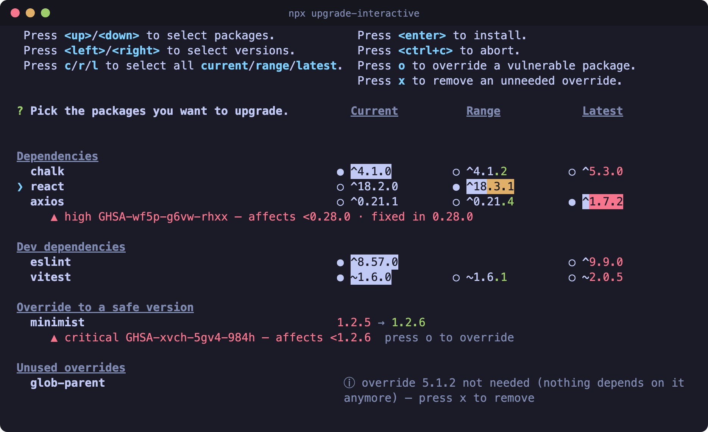

# upgrade-interactive

[](https://www.npmjs.com/package/upgrade-interactive)
[](https://www.npmjs.com/package/upgrade-interactive)
[](https://www.npmjs.com/package/upgrade-interactive)
[](./LICENSE)

An interactive dependency upgrader for npm projects, inspired by `yarn
upgrade-interactive`. A three-column Current/Range/Latest picker, plus built-in
**vulnerability warnings** and one-key npm **`overrides`**.

<p align="center">
  
</p>

## Install / run

```sh
npx upgrade-interactive
# or install globally:
npm install -g upgrade-interactive
nui
```

Requires Node 18+ and an interactive terminal.

## What it does

- **Pick upgrades** per package — Current, Range (the newest version your range
  allows) or Latest — keeping your `^` / `~` / exact modifier. Packages with
  nothing new are left out.
- **See vulnerabilities** in direct and transitive dependencies: severity, CVE
  link, affected range and first fixed version.
- **Fix them with `o`**: pins a safe version via npm `overrides` — per dependent
  when the package is installed at several versions, or a range bump when it's
  one of your direct dependencies. When no pin can be written, the row says why.
  If your own overrides hold the vulnerable version, it names them and the
  `npm update <pkg>` that fixes it once they're removed. When a version would
  take dependents past the major they declare, the picker names them first, and
  it never offers one below a safe pin you already have. A row whose fix every
  dependent's range already allows says so: `npm update <pkg>` lands it with no
  pin.
- **Clean up with `x`**: removes an override that's no longer needed.
- In a workspace repo, **see overrides npm never applied** (see [Notes](#notes)).

On `Enter` it writes your choices to `package.json` and runs `npm install`. It
then reads the lockfile npm wrote, and names any pin npm didn't apply, with the
command that lands it, and anything still vulnerable.

## Controls

| Key               | Action                                                                     |
| ----------------- | -------------------------------------------------------------------------- |
| `↑` / `↓`         | Move between packages                                                      |
| `←` / `→`         | Move between Current / Range / Latest, skipping columns a package lacks    |
| `c` / `r` / `l`   | Select that column for every package; one that lacks it falls back lower   |
| `o`               | Pin the focused vulnerable package to a safe version                       |
| `x`               | Remove the focused override that's no longer needed                        |
| `Enter`           | Apply, then run `npm install`                                              |
| `Esc` / `Ctrl+C`  | Abort — nothing is written                                                 |

## Flags

| Setting                         | Flag                         | Env var       | Config key | Default |
| ------------------------------- | ---------------------------- | ------------- | ---------- | ------- |
| Run `npm install` after writing | `--install` / `--no-install` | `NUI_INSTALL` | `install`  | on      |
| Vulnerability check             | `--audit` / `--no-audit`     | `NUI_AUDIT`   | `audit`    | on      |
| Group the list into sections    | `--section` / `--no-section` | `NUI_SECTION` | `section`  | on      |

A flag beats the env var (`0`, `false`, `no` or `off` turns it off), which beats
the config block in `package.json`:

```json
"upgrade-interactive": { "install": false, "audit": false, "section": true }
```

Also `-w, --workspace <name>` and `--no-workspaces` (see
[Workspaces](#workspaces)), `-h, --help` and `-v, --version`.

The vulnerability check needs network access; offline, the tool says so and
upgrades still work.

## Workspaces

In an npm workspaces repo, run it from anywhere in the tree — including inside a
workspace — and it covers the whole repo. Each workspace gets its own section
(root first, kept under `--no-section`), and its edits go to its own
`package.json`. `overrides`, `npm install` and the config block belong to the
root; a workspace's own config block is ignored, with a note when that changes
the run.

```console
$ nui -w packages/api      # limit to a workspace by path…
$ nui -w @acme/web         # …or by package name; repeatable
$ nui --no-workspaces      # the root package.json only
```

npm honours `overrides` only at the root, so a vulnerable package whose
workspaces declare *different* ranges can't be fixed by one override. Those rows
offer no pin — upgrade each workspace's row instead. This holds under
`--no-workspaces` too.

The `workspaces` field supports literal paths, `*` within a path segment, a
trailing `**` and `!` exclusions — not `?`, `[a-z]`, `{a,b}` or a non-trailing
`**`. Unlike npm, `*` also matches directories starting with a dot.

## Notes

- **Compound ranges** (`>=1.0.0 <2.0.0`, `1.x || 2.x`) have no single modifier to
  re-apply, so they collapse to a caret. Protocol ranges (git/file/link/workspace,
  npm aliases) are skipped.
- Unlike yarn, **Latest** isn't offered when npm's `latest` tag is older than
  what your range already allows, since that would be a downgrade.
- Only `dependencies` and `devDependencies` are scanned.
- Pinning a package **and** something under it share one entry, using npm's
  `"."` key: `"vite": { ".": "7.3.6", "picomatch": "4.0.5" }`.
- **Some override pins are refused** — ones npm would ignore, reject
  (`EOVERRIDE`), or apply to copies of a package you didn't target. The picker
  says why. Two cases aren't guarded yet: npm 11.1 and earlier can drop one of
  two `parent@version` pins when the root also depends on that parent, and on a
  fresh install a `parent@version` key also pins the parent itself to that
  version, which can downgrade it.
- **A global pin can move copies an advisory doesn't affect**, when a package is
  installed at several majors and only the newer ones are vulnerable. The picker
  names the copies that are already safe. To leave them alone, write a key that
  starts where the advisory does, such as `"minimatch@>=7": "11.0.4"`, by hand;
  the tool doesn't write one yet. npm applies it like any other override.
- **In a workspace repo, npm often doesn't apply a new override.** A package
  already in the lockfile that only a workspace depends on keeps its version, and
  on npm 11 so does one the same install adds. A standalone project applies
  overrides on its next `npm install`. After installing, the tool says which pins
  didn't land. One inside what its dependents declare needs no pin: delete it and
  run `npm update <pkg>`. One outside lands with `npm update` on some npm releases
  and otherwise only with `rm -rf node_modules package-lock.json && npm install`,
  which re-resolves every dependency. Both can also apply your older overrides
  that weren't in effect, so the tool names those first. It reports all of this
  rather than running it.

## Contributing

See [CONTRIBUTING.md](CONTRIBUTING.md) for setup, tests, and capturing a run
against a real project.

## License

MIT
